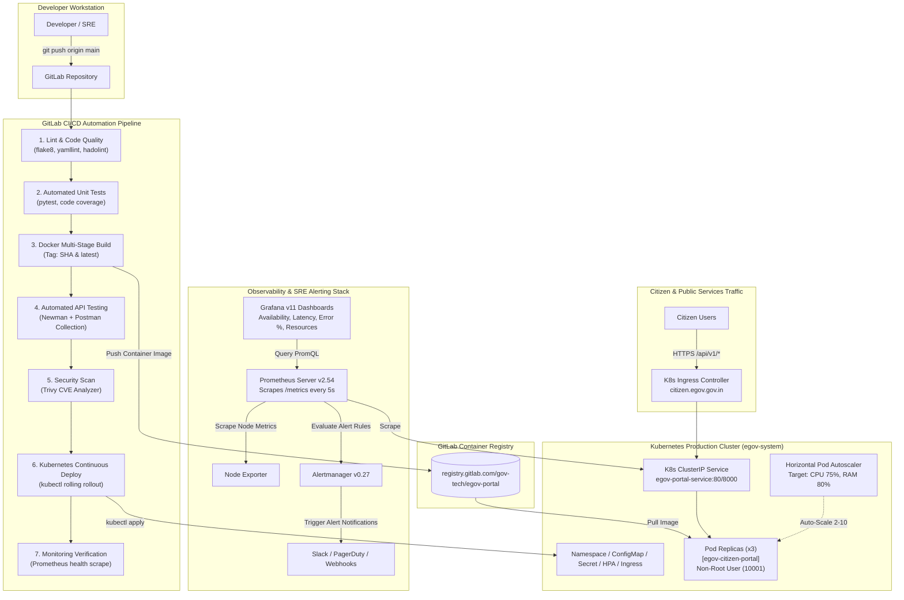

# End-to-End DevOps Pipeline for E-Governance Application

An enterprise-grade, highly available DevOps pipeline for an **E-Governance Citizen Services Platform** incorporating **GitLab CI/CD**, **Docker**, **Postman/Newman**, **Kubernetes (K8s)**, **Prometheus**, and **Grafana**.

---

## 🏛️ System Architecture



---

## 📁 Repository Structure

```
egov-devops-pipeline/
├── .gitlab-ci.yml                           # 7-stage enterprise GitLab CI/CD pipeline
├── Dockerfile                               # Multi-stage production container with non-root security
├── .dockerignore                            # Build context filter
├── docker-compose.yml                       # Unified local stack (App, Prometheus, Grafana, Alertmanager)
├── requirements.txt                         # Python dependencies (FastAPI, Prometheus Client, Pytest)
├── README.md                                # Comprehensive architectural and operations documentation
│
├── app/                                     # E-Governance Microservice Source Code
│   ├── main.py                              # FastAPI REST service with Prometheus metrics & chaos hooks
│   ├── config.py                            # Settings loaded via ConfigMap / Secrets
│   └── models.py                            # Pydantic citizen schemas (Vital records, Grievance, Chaos)
│
├── tests/                                   # Automated Unit and Integration Tests
│   ├── __init__.py
│   └── test_api.py                          # Pytest suite with health probe and metrics validations
│
├── postman/                                 # Automated API Regression & SLA Test Suite
│   ├── egov_citizen_api.postman_collection.json # 8 automated tests with JavaScript assertions
│   └── egov_staging.postman_environment.json    # Target environment variables
│
├── k8s/                                     # Production Kubernetes Manifests
│   ├── 00-namespace.yaml                    # egov-system namespace with ResourceQuotas
│   ├── 01-configmap.yaml                    # Application runtime environment variables
│   ├── 02-secret.yaml                       # Database credentials and API authentication keys
│   ├── 03-deployment.yaml                   # 3 replicas, RollingUpdate, Liveness/Readiness probes
│   ├── 04-service.yaml                      # ClusterIP service with Prometheus scraping annotations
│   ├── 05-hpa.yaml                          # Horizontal Pod Autoscaler (2 - 10 replicas)
│   ├── 06-ingress.yaml                      # TLS Ingress routing citizen traffic
│   └── 07-servicemonitor.yaml               # Prometheus Operator Custom Resource Definition (CRD)
│
├── monitoring/                              # Observability & Alerting Configurations
│   ├── prometheus.yml                       # Prometheus server scrape jobs and intervals
│   ├── alert_rules.yml                      # Production alert rules (ServiceDown, ErrorRate, Latency, CPU)
│   ├── alertmanager.yml                     # Alert routing, inhibitor rules, and webhook targets
│   └── grafana/
│       ├── provisioning/
│       │   ├── datasources/prometheus.yaml  # Automated Prometheus datasource provider
│       │   └── dashboards/dashboards.yaml   # Automatic dashboard auto-loader
│       └── dashboards/
│           └── egov_service_dashboard.json  # Comprehensive Grafana dashboard JSON
│
└── scripts/                                 # Automation & Failure Simulation Tools
    ├── run_local_demo.py                    # Complete end-to-end automated demo runner
    ├── mock_server.py                       # Zero-dependency E-Gov portal engine & dispatcher
    ├── simulate_failure.py                  # Step-by-step incident injection & alert verification
    ├── simulate_failure.ps1                 # PowerShell failure simulator for Windows
    └── test_postman_with_python.py          # Newman-style automated Postman runner
```

---

## 🛠️ Key Pipeline Components

### 1. GitLab CI/CD Pipeline (`.gitlab-ci.yml`)
The pipeline runs automatically upon commit/merge request and enforces strict quality gates:

| Stage | Job Name | Tooling | Purpose & Verification |
| :--- | :--- | :--- | :--- |
| **1. Lint** | `lint:code-and-manifests`<br/>`lint:dockerfile` | flake8, yamllint, hadolint | Enforces PEP8 compliance, validates K8s/Prometheus YAML, checks Dockerfile security best practices. |
| **2. Unit Test** | `test:unit` | Pytest, pytest-cov | Executes unit and integration test suite; produces JUnit XML and Cobertura coverage reports. |
| **3. Container Build** | `build:docker-image` | Docker BuildKit, dind | Multi-stage build pushing `$CI_COMMIT_SHORT_SHA` and `latest` tags to GitLab Container Registry. |
| **4. API Test** | `test:postman-newman` | Newman CLI (`postman/newman:alpine`) | Spawns application container as a network service and executes Postman collection assertions. |
| **5. Security** | `security:trivy-scan` | Aqua Security Trivy | Scans container layers for HIGH and CRITICAL CVE vulnerabilities. |
| **6. Continuous Deploy** | `deploy:kubernetes-production` | `bitnami/kubectl` | Updates image tag, deploys ConfigMaps/Secrets/Deployments, verifies rolling rollout zero-downtime. |
| **7. Verify & Monitor** | `verify:monitoring-and-prometheus` | cURL | Verifies `/healthz` liveness and confirms Prometheus metrics `/metrics` are actively exposed. |

### 2. Multi-Stage Hardened Docker Container (`Dockerfile`)
- **Stage 1 (Builder)**: Installs build-time packages (`gcc`, `libpq-dev`), resolves dependencies into wheels, keeping the build environment separate.
- **Stage 2 (Runtime)**: Minimal `python:3.11-slim` runtime.
- **Non-Root User**: Runs as `egovuser` (UID 10001 / GID 10001) for defense-in-depth against container escapes.
- **Healthcheck**: Embedded `HEALTHCHECK` probe querying `/healthz` every 15s.

### 3. Automated API Testing with Postman & Newman (`postman/`)
The Postman collection (`egov_citizen_api.postman_collection.json`) validates end-to-end citizen transaction flows:
1. **Liveness Probe**: `GET /healthz` -> HTTP 200, status `HEALTHY`, response time < 150ms SLA.
2. **Readiness Probe**: `GET /ready` -> HTTP 200, `ready_for_traffic == true`.
3. **Prometheus Exposition**: `GET /metrics` -> HTTP 200, Content-Type `text/plain`, contains `egov_http_requests_total`.
4. **Public Services Catalog**: `GET /api/v1/services` -> HTTP 200, returns active citizen services.
5. **Submit Citizen Application**: `POST /api/v1/applications` -> HTTP 201, generates `APP-XXXXXX` and tracking code.
6. **Query Application Status**: `GET /api/v1/applications/:id` -> HTTP 200, tracks application lifecycle.
7. **Lodge Citizen Grievance**: `POST /api/v1/grievances` -> HTTP 201, assigns Municipal Officer with SLA.
8. **Negative Schema Validation**: `POST /api/v1/applications` with invalid code -> HTTP 400 Bad Request.

Executed in CI/CD via:
```bash
newman run postman/egov_citizen_api.postman_collection.json \
  --environment postman/egov_staging.postman_environment.json \
  --reporters cli,junit \
  --reporter-junit-export newman-report.xml
```

### 4. Kubernetes Manifests (`k8s/`)
- **Namespace & Quota** (`00-namespace.yaml`): Dedicated `egov-system` namespace with CPU/Memory limits.
- **ConfigMap & Secrets** (`01-configmap.yaml`, `02-secret.yaml`): Decoupled configuration and encrypted credentials.
- **High-Availability Deployment** (`03-deployment.yaml`):
  - 3 replicas with `podAntiAffinity` across nodes.
  - Zero-downtime rolling update strategy (`maxSurge: 1`, `maxUnavailable: 0`).
  - Active `livenessProbe` (`/healthz`) and `readinessProbe` (`/ready`).
  - Strict `securityContext`: `runAsNonRoot: true`, `allowPrivilegeEscalation: false`, drop all Linux capabilities.
- **Horizontal Pod Autoscaler** (`05-hpa.yaml`): Scales from 2 to 10 pods when CPU utilization exceeds 75% or memory exceeds 80%.
- **Ingress** (`06-ingress.yaml`): NGINX Ingress routing traffic for `citizen.egov.gov.in`.

### 5. Prometheus Metrics & Alerting (`monitoring/`)
Exposed at `/metrics`:
- `egov_http_requests_total`: Request counter labelled by `method`, `endpoint`, and `status_code`.
- `egov_http_request_duration_seconds`: Histogram measuring latency percentiles (p50, p95, p99).
- `egov_service_health_status`: Gauge (1.0 = HEALTHY, 0.0 = UNHEALTHY).
- `egov_active_grievances_total`: Active citizen grievances gauge.
- `egov_applications_processed_total`: Applications processed counter by `service_code`.

#### Production Alert Rules (`monitoring/alert_rules.yml`):
- **`EgovServiceDown` (Severity: Critical)**:
  `expr: (up{job="egov-portal"} == 0) or (egov_service_health_status == 0)` for `15s`.
- **`EgovHighHttpErrorRate` (Severity: High)**:
  `expr: (sum(rate(egov_http_requests_total{status_code=~"5.."}[1m])) / sum(rate(egov_http_requests_total[1m]))) * 100 > 10` for `30s`.
- **`EgovHighResponseLatency` (Severity: Warning)**:
  `expr: histogram_quantile(0.95, sum(rate(egov_http_request_duration_seconds_bucket[1m])) by (le)) > 0.500` for `30s`.
- **`EgovHighMemoryUtilization` (Severity: Warning)**:
  `expr: (process_resident_memory_bytes{job="egov-portal"} / 1024 / 1024) > 400` for `1m`.

### 6. Grafana Operational Dashboard (`monitoring/grafana/`)
Importable dashboard (`monitoring/grafana/dashboards/egov_service_dashboard.json`) featuring:
1. **Executive SLA Summary**:
   - Service Availability (Uptime SLA % gauge: Green > 99.5%, Yellow > 98%, Red < 98%).
   - Health Status Single Stat (ONLINE / DOWN).
   - P95 Response Latency (ms).
   - Citizen Request Throughput (requests/sec).
2. **Response Time Analysis**:
   - p50, p90, p95 (500ms SLA threshold line), and p99 latency trends.
   - Per-endpoint throughput breakdown.
3. **Error Rates & Outage Anomaly Detection**:
   - HTTP 2xx vs 4xx vs 5xx distribution.
   - HTTP 5xx failure ratio vs 10% SLA alert threshold.
4. **Infrastructure Utilization**:
   - Process Resident Memory (RSS) vs limits.
   - CPU Cores consumed.
5. **Business Governance Telemetry**:
   - Active citizen grievances.
   - Applications processed by category (Birth Certificates, Land Mutation, Trade Licenses).

---

## ⚡ Failure Simulation & Alert Demonstration

The repository includes a simulation suite demonstrating how the observability stack reacts to service failures.

### Execution Commands:

#### Option 1: Automated All-in-One Local Demonstration Runner
```bash
python scripts/run_local_demo.py
```

#### Option 2: Run via Docker Compose (Full Containerized Stack)
```bash
# 1. Start App, Prometheus, Alertmanager, Grafana, Node-Exporter
docker compose up -d

# 2. Access Dashboards:
#    - E-Gov Application: http://localhost:8000/docs
#    - Prometheus UI    : http://localhost:9090/alerts
#    - Alertmanager UI  : http://localhost:9093
#    - Grafana Dashboard: http://localhost:3000 (admin / admin)

# 3. Run automated failure simulation
python scripts/simulate_failure.py
```

#### Option 3: PowerShell Runner (Windows)
```powershell
.\scripts\simulate_failure.ps1
```

---

## 🔬 Incident Lifecycle Verification Logs

When executing `scripts/run_local_demo.py`, the pipeline undergoes the exact failure, alert, and self-healing lifecycle:

```text
================================================================================
  [*] E-GOVERNANCE DEVOPS PIPELINE: LOCAL AUTOMATION & DEMONSTRATION
================================================================================
Initializing E-Governance microservice environment...

>>> RUNNING STEP 1: Automated API Testing (Postman / Newman Suite)

================================================================================
  NEWMAN / POSTMAN AUTOMATED API TEST RUNNER - E-GOVERNANCE SUITE
================================================================================
Collection : E-Governance Citizen Portal API Automated Test Suite
Target URL : http://127.0.0.1:8000
Total Tests: 8
--------------------------------------------------------------------------------
[ PASS ] Test 01: 01 - Kubernetes Liveness Probe                | GET  200 |   0.4ms
[ PASS ] Test 02: 02 - Kubernetes Readiness Probe               | GET  200 |   0.1ms
[ PASS ] Test 03: 03 - Prometheus Metrics Exposition            | GET  200 |   0.1ms
[ PASS ] Test 04: 04 - List Public Governance Services          | GET  200 |   0.1ms
[ PASS ] Test 05: 05 - Submit Citizen Application               | POST 201 |   0.3ms
[ PASS ] Test 06: 06 - Query Application Tracking Status        | GET  200 |   0.1ms
[ PASS ] Test 07: 07 - Lodge Citizen Grievance                  | POST 201 |   0.2ms
[ PASS ] Test 08: 08 - Negative Test: Reject Invalid Service Code | POST 400 |   0.1ms
--------------------------------------------------------------------------------
Postman Suite Execution Completed: 8 Passed, 0 Failed | Duration: 1.4ms
================================================================================

[PASS] Automated API Regression Test Suite: 100% Passed (Quality Gate Met)

>>> RUNNING STEP 2: Simulated Service Failure & Prometheus Alert Generation

================================================================================
  [*] E-GOVERNANCE SRE INCIDENT & ALERT GENERATION DEMONSTRATION
================================================================================
Target App: http://127.0.0.1:8000
Prometheus: http://127.0.0.1:9090

[STEP 1] Verifying Baseline Operational Health
------------------------------------------------------------
[PASS] Liveness Probe : HTTP 200 (status: HEALTHY)
[PASS] Uptime         : 0.48s
[PASS] Dependencies   : {'database': 'UP', 'identity_vault': 'UP'}
   [Metric] egov_service_health_status 1.0

[STEP 2] Injecting Simulated Service Failure (Chaos Mode)
------------------------------------------------------------
[!] Triggering failure on endpoint: POST /api/v1/chaos/simulate-crash
   Response HTTP 200: Service health set to 0. /healthz will return HTTP 503.
[!] Verifying Kubernetes Liveness Probe failure:
   GET /healthz => HTTP 503 (Service Degradation Confirmed)

[STEP 3] Evaluating Prometheus Alert Rule Transitions
------------------------------------------------------------
Reading current Prometheus metrics state:
   [Metric Value] egov_service_health_status 0.0  <-- DROPPED TO 0.0 (OUTAGE)

Prometheus Alert Rule Logic:
   Rule Name    : EgovServiceDown
   Expression   : (up{job="egov-portal"} == 0) or (egov_service_health_status == 0)
   Severity     : CRITICAL
   Wait Duration: 15s

   [Simulating Prometheus Evaluation Loop]
   [t + 0s]  Alert State: INACTIVE  | Outage condition detected on scrape
   [t + 5s]  Alert State: PENDING   | Condition persists. Scrape returned health=0
   [t + 15s] Alert State: FIRING    | Threshold exceeded 'for: 15s'. ALERT DISPATCHED TO ALERTMANAGER!

[STEP 4] Alertmanager Notification Dispatch (Slack / PagerDuty / Webhook)
------------------------------------------------------------
{
  "version": "4",
  "groupKey": "{}:{alertname=\"EgovServiceDown\", service=\"egov-citizen-portal\"}",
  "status": "firing",
  "receiver": "pager-duty-critical",
  "alerts": [
    {
      "status": "firing",
      "labels": {
        "alertname": "EgovServiceDown",
        "severity": "critical",
        "service": "egov-citizen-portal",
        "namespace": "egov-system"
      },
      "annotations": {
        "summary": "E-Governance Citizen Portal is DOWN or Failing Health Probes",
        "description": "Instance egov-citizen-portal has failed /healthz liveness checks. Citizen services unavailable."
      }
    }
  ]
}

[STEP 5] Simulating HTTP 500 Error Flood Scenario
------------------------------------------------------------
[!] Injecting 80% error rate via POST /api/v1/chaos/inject-errors?error_rate=0.8
   Sending 25 citizen transactions through degraded gateway...
   Traffic Results: 4 HTTP 200 OK | 21 HTTP 500 ERRORS (84.0%)
   Alert Rule 'EgovHighHttpErrorRate' threshold is 10%. Actual: 84.0% => [FIRING]

[STEP 6] Automated Kubernetes Pod Restart & Self-Healing Recovery
------------------------------------------------------------
[K8s] Kubernetes Liveness probe failure detected by kubelet.
      Kubelet action: Restarting failing pod 'egov-citizen-portal-7d9fb-x829z'
      Restoring pristine service state...
      Reset response HTTP 200: All failure simulations cleared. Service returned to healthy state.

   Verifying recovered health probes:
   GET /healthz => HTTP 200 | Status: HEALTHY

   Prometheus Alert State: [RESOLVED]
   Grafana Dashboard Panels returned to GREEN SLA thresholds.

================================================================================
  [SUCCESS] SIMULATION COMPLETE: ALL ALERT LIFECYCLE STAGES VERIFIED
================================================================================
```

---

## 🔒 Security & Reliability Best Practices Implemented

1. **Least Privilege Container Runtime**: Execution restricted to dedicated non-root user UID 10001 (`egovuser`), forbidding root privilege escalation.
2. **Kubernetes Defense-in-Depth**:
   - `ResourceQuota` preventing "noisy neighbor" compute starvation in cluster.
   - `RollingUpdate` with `maxUnavailable: 0` ensuring 100% SLA during continuous deployments.
   - `PodAntiAffinity` spreading replicas across distinct worker nodes.
3. **Automated Quality Gates**:
   - Postman API contract testing executed via Newman in CI before any deployment occurs.
   - Static analysis with `flake8`, `yamllint`, and `hadolint`.
   - CVE vulnerability scanning with `trivy`.
4. **Self-Healing Infrastructure**:
   - Kubernetes kubelet automatically detects failed `/healthz` probes and restarts corrupted containers.
   - Alertmanager silences downstream noise during complete outages using inhibition rules.
